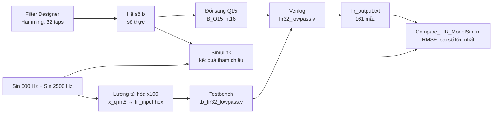

# 🎛️ Bộ lọc FIR thông thấp 32 hệ số: MATLAB → Simulink → Verilog → ModelSim

Project môn **DGT302**: thiết kế bộ lọc **FIR thông thấp** bằng phương pháp cửa sổ Hamming, kiểm chứng trên **MATLAB/Simulink**, hiện thực bằng **Verilog** và so sánh kết quả mô phỏng **ModelSim** với MATLAB.

> **Kết quả nổi bật:** 161/161 mẫu đầu ra của Verilog khớp với MATLAB, sai số lớn nhất ≈ **0,0095**, RMSE ≈ **0,0060** (nhỏ hơn 1 bước lượng tử 0,01).

---

## 📑 Mục lục

1. [Giới thiệu](#1-giới-thiệu)
2. [Thông số thiết kế](#2-thông-số-thiết-kế)
3. [Quy trình thực hiện](#3-quy-trình-thực-hiện)
4. [Cấu trúc thư mục](#4-cấu-trúc-thư-mục)
5. [Lý thuyết tóm tắt](#5-lý-thuyết-tóm-tắt)
6. [Thiết kế trên MATLAB và Simulink](#6-thiết-kế-trên-matlab-và-simulink)
7. [Hiện thực Verilog và mô phỏng ModelSim](#7-hiện-thực-verilog-và-mô-phỏng-modelsim)
8. [Kết quả](#8-kết-quả)
9. [Hướng dẫn chạy lại](#9-hướng-dẫn-chạy-lại)
10. [Hạn chế và hướng phát triển](#10-hạn-chế-và-hướng-phát-triển)
11. [Thành viên và tài liệu](#11-thành-viên-và-tài-liệu)

---

## 1. Giới thiệu

Tín hiệu thực tế thường lẫn nhiễu hoặc các thành phần tần số không cần thiết. **Bộ lọc FIR** (Finite Impulse Response) là công cụ cơ bản để loại bỏ chúng vì:

- **Luôn ổn định** (không có phản hồi).
- **Pha tuyến tính** khi hệ số đối xứng, nên tín hiệu không bị méo dạng.
- **Dễ làm bằng phần cứng**: chỉ gồm thanh ghi trễ, phép nhân và phép cộng.

Project đi trọn một quy trình thiết kế thực tế: **tính toán phần mềm → hiện thực phần cứng mô tả → mô phỏng → so sánh với mô hình chuẩn**.

**Mục tiêu**

- Thiết kế FIR thông thấp 32 hệ số (Fs = 8000 Hz, Fc = 1000 Hz, cửa sổ Hamming).
- Kiểm tra bộ lọc giữ lại thành phần **500 Hz** và loại bỏ thành phần **2500 Hz**.
- Đổi hệ số sang số nguyên cố định **Q15**, đầu vào sang **int8**, đưa vào Verilog.
- Chạy 161 mẫu trên ModelSim và đánh giá sai số bằng **RMSE** và **sai số lớn nhất**.

---

## 2. Thông số thiết kế

| Thông số | Giá trị |
|---|---|
| Loại bộ lọc | FIR thông thấp (Lowpass) |
| Phương pháp | Window Method |
| Cửa sổ | Hamming |
| Bậc / số hệ số | 31 / **32** |
| Tần số lấy mẫu Fs | 8000 Hz |
| Tần số cắt Fc | 1000 Hz (suy giảm ≈ 6 dB tại Fc) |
| Cấu trúc | Direct-Form FIR |
| Định dạng hệ số | Q15 (`int16`) |
| Định dạng đầu vào | `int8`, hệ số tỷ lệ `X_SCALE = 100` |
| Tín hiệu thử | 500 Hz + 2500 Hz |
| Thời gian mô phỏng | 0,02 s → **161 mẫu** |
| Độ trễ nhóm | (32 − 1)/2 = 15,5 mẫu ≈ 1,94 ms |

---

## 3. Quy trình thực hiện



---

## 4. Cấu trúc thư mục

> Cấu trúc dưới đây dựa trên các file nhóm đang có. Hãy chỉnh lại nếu bạn sắp xếp khác.

```text
.
├── README.md
├── matlab/
│   ├── Filter Coefficient.fda        # Phiên Filter Designer đã lưu
│   ├── Fir_Lowpass_Analysis.m        # Phân tích đáp ứng tần số, so sánh trước/sau lọc
│   ├── FIR_Lowpass_Model.slx         # Mô hình Simulink
│   ├── FIR_Lowpass_Reference.mat     # Đáp ứng tham chiếu của MATLAB
│   ├── Export_FIR_Data.m             # Xuất hệ số Q15 và dữ liệu vào cho Verilog
│   ├── FIR_Verilog_Data.mat          # B_Q15, x_q, X_SCALE
│   └── Compare_FIR_ModelSim.m        # So sánh MATLAB với ModelSim, tính RMSE
├── modelsim/
│   ├── fir32_lowpass.v               # Module FIR 32 hệ số
│   ├── tb_fir32_lowpass.v            # Testbench
│   ├── fir_input.hex                 # 161 mẫu đầu vào (do MATLAB xuất)
│   └── fir_output.txt                # 161 mẫu đầu ra (do ModelSim ghi)
└── docs/
    ├── BaoCao_FIR_Lowpass.pdf        # Báo cáo đầy đủ
    └── images/                       # Ảnh minh họa dùng trong README
```

---

## 5. Lý thuyết tóm tắt

**Phương trình FIR** (N = 32 hệ số):

```text
y[n] = Σ b[k] · x[n−k],   k = 0 … N−1
```

**Tần số cắt chuẩn hóa:** `ωc = 2π·Fc/Fs = π/4`.

**Window Method:** lấy đáp ứng xung lý tưởng (hàm sinc) rồi nhân với cửa sổ **Hamming** `w[n] = 0,54 − 0,46·cos(2πn/(N−1))` để cắt về 32 mẫu. Hamming giúp dải chặn "sạch" hơn (gợn sóng nhỏ) nhưng vùng chuyển tiếp rộng hơn một chút.

**Q15:** số nguyên 16 bit có dấu với 15 bit phần thập phân.

```text
Q15 = round(giá_trị_thực × 32768)
```

Ví dụ: `b[0] ≈ −0,00064` → **−21**. Sau khi nhân – cộng, kết quả được **dịch phải 15 bit** để về lại đúng thang đo.

---

## 6. Thiết kế trên MATLAB và Simulink

1. Dùng **Filter Designer** (`filterDesigner`) với các thông số ở mục 2.
2. Xuất vector `b` (32 hệ số, đối xứng) và đổi sang `B_Q15`.
3. Tạo tín hiệu thử gồm sin 500 Hz và 2500 Hz.
4. Mô hình Simulink gồm: **2 × Sine Wave → Sum → Discrete Filter `b(z)/1` → Scope** (Stop Time = 0,02 s).
5. Chạy `Export_FIR_Data.m` để xuất `fir_input.hex` và `FIR_Verilog_Data.mat`.

**Hệ số Q15 (đối xứng):**

| Nhóm | Giá trị |
|---|---|
| 5 hệ số đầu `b[0..4]` | −21, −60, −84, −52, 78 |
| 5 hệ số cuối `b[27..31]` | 78, −52, −84, −60, −21 |

**Đáp ứng tần số:**

| Tần số | Mức suy giảm (xấp xỉ) |
|---|---|
| ≤ 500 Hz | gần 0 dB (dải thông) |
| 1000 Hz | ≈ −6 dB |
| ≥ 1500 Hz | < −50 dB |
| 2500 Hz | ≈ −65 đến −67 dB |


Sau lọc, tín hiệu chỉ còn sóng **500 Hz** biên độ ≈ 0,69; thành phần 2500 Hz gần như biến mất.

---

## 7. Hiện thực Verilog và mô phỏng ModelSim

### Module `fir32_lowpass`

| Tín hiệu | Ý nghĩa |
|---|---|
| `clk` | Xung nhịp, mỗi xung xử lý một mẫu |
| `rst_n` | Reset mức thấp |
| `x_in` | Mẫu vào, số nguyên có dấu 8 bit |
| `y_out` | Mẫu ra, số nguyên có dấu (thang ×100) |
| `h[0..31]` | 32 hệ số Q15 |
| `acc` | Bộ cộng dồn |

Mỗi xung nhịp: **dịch mẫu → nhân với hệ số → cộng dồn → dịch phải 15 bit → `y_out`**.

Ví dụ kiểm chứng trong ModelSim: `acc = 453445` → `453445 / 32768 ≈ 13,84` → `y_out = 13`.

### Testbench `tb_fir32_lowpass.v`

- Tạo `clk`, `rst_n`.
- Đọc `fir_input.hex` vào `input_mem` bằng `$readmemh` (161 mẫu).
- Đưa từng mẫu vào `x_in`, ghi `y_out` ra `fir_output.txt`.
- In thông báo `Da xu ly xong 161 mau!` và dừng bằng `$stop`.

Hệ số trong ModelSim đã được kiểm tra bằng lệnh `examine -radix decimal` và **trùng khớp** `B_Q15` của MATLAB (`h[0] = −21`, `h[1] = −60`, `h[2] = −84`, `h[3] = −52`, `h[4] = 78`, …).


Tổng thời gian mô phỏng: **1626 ns** (≈ 10 ns/mẫu).

---

## 8. Kết quả

Script `Compare_FIR_ModelSim.m` đọc `fir_output.txt`, chia cho `X_SCALE = 100` rồi so với đáp ứng tham chiếu của MATLAB.

| Chỉ số | Giá trị |
|---|---|
| Số mẫu đầu vào | 161 |
| Số mẫu đầu ra ModelSim | 161 |
| Sai số tuyệt đối lớn nhất | **0,00954506** |
| RMSE | **0,00601066** |


**Nhận xét**

- Hai đường đồ thị chồng khít trên toàn bộ 161 mẫu, kể cả đoạn quá độ.
- Sai số không tăng theo thời gian (không tích lũy) và lặp lại theo chu kỳ 16 mẫu của sóng 500 Hz.
- Sai số lớn nhất ≈ 0,0095 chỉ ≈ 1,4 % biên độ đầu ra (≈ 0,69) và nhỏ hơn một bước lượng tử (1/100 = 0,01). Nguyên nhân chính là cắt phần lẻ khi dịch phải 15 bit, cùng với lượng tử hóa đầu vào (int8) và hệ số (Q15).

---

## 9. Hướng dẫn chạy lại

**Yêu cầu:** MATLAB (có Signal Processing Toolbox và Simulink, nhóm dùng R2025a) và ModelSim (nhóm dùng Intel FPGA Starter Edition 2020.1).

> 💡 Nên đặt tên thư mục **không có dấu cách** (ví dụ `fir_lowpass`) để tránh lỗi đường dẫn trong ModelSim.

**Bước 1. Tạo dữ liệu bằng MATLAB**

```matlab
cd matlab
Fir_Lowpass_Analysis    % thiết kế, phân tích đáp ứng tần số
Export_FIR_Data         % xuất B_Q15, fir_input.hex, FIR_Verilog_Data.mat
```

**Bước 2. Mô phỏng bằng ModelSim**

1. Tạo project mới, thêm `fir32_lowpass.v` và `tb_fir32_lowpass.v`.
2. Đặt `fir_input.hex` đúng thư mục làm việc (hoặc sửa đường dẫn trong testbench).
3. Compile, rồi chạy mô phỏng module `tb_fir32_lowpass`:

```tcl
vsim work.tb_fir32_lowpass
add wave -r sim:/tb_fir32_lowpass/*
run -all
```

4. Kết quả được ghi vào `fir_output.txt`.

**Bước 3. So sánh kết quả**

```matlab
Compare_FIR_ModelSim    % in sai số lớn nhất, RMSE và vẽ đồ thị
```

---

## 10. Hạn chế và hướng phát triển

**Hạn chế**

- Mới dừng ở mô phỏng, chưa nạp lên FPGA nên chưa có số liệu tài nguyên và tốc độ.
- Chỉ thử một tín hiệu (500 Hz + 2500 Hz) và một bộ thông số.
- Đầu ra bị cắt phần lẻ (chưa làm tròn).
- Dùng 32 phép nhân song song nên tốn tài nguyên.

**Hướng phát triển**

- [ ] Thêm bước làm tròn (cộng 2¹⁴ trước khi dịch phải) để giảm sai số.
- [ ] Tăng độ rộng bit đầu vào/đầu ra.
- [ ] Tận dụng hệ số đối xứng để giảm một nửa số phép nhân.
- [ ] Thử cửa sổ khác (Hann, Blackman) hoặc tăng số hệ số.
- [ ] Viết testbench tự kiểm tra (tự so sánh, báo pass/fail).
- [ ] Tổng hợp và nạp lên FPGA, kết nối ADC/DAC với tín hiệu thật.
- [ ] Mở rộng sang bộ lọc thông cao và thông dải.

---

## 11. Thành viên và tài liệu

| Họ tên | MSSV | Vai trò |
|---|---|---|
| [Tên thành viên 1] | [MSSV] | [Vai trò] |
| [Tên thành viên 2] | [MSSV] | [Vai trò] |
| [Tên thành viên 3] | [MSSV] | [Vai trò] |

**Giảng viên hướng dẫn:** [Tên giảng viên]

**Tài liệu tham khảo**

1. A. V. Oppenheim, R. W. Schafer, *Discrete-Time Signal Processing*, Pearson.
2. S. J. Orfanidis, *Introduction to Signal Processing*, Prentice Hall.
3. MathWorks, tài liệu *Filter Designer* và *Simulink*.

**Giấy phép:** [Chọn license, ví dụ MIT, hoặc ghi "Dùng cho mục đích học tập"].
